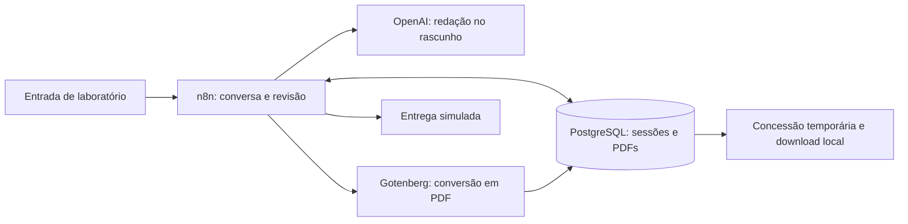

# Gerador de currículos por conversa

**Projeto em desenvolvimento · demonstração pública ainda indisponível**

Este projeto nasceu de uma necessidade observada na papelaria da minha família: ajudar moradores a transformar relatos sobre trabalho, inclusive experiências informais, em um currículo que possam encaminhar ou imprimir. A proposta é oferecer esse atendimento gratuitamente por uma conversa simples. O WhatsApp é o canal planejado; nesta fase, o fluxo funciona em um laboratório local.

## O que já funciona

O n8n conduz a coleta de dados, guarda o estado de cada conversa no PostgreSQL e permite revisar e corrigir as informações antes de redigir. Há caminhos para primeiro emprego, experiências informais e campos opcionais. Após aprovação, o fluxo gera HTML, converte-o em PDF com Gotenberg, armazena o arquivo no banco e prepara uma concessão temporária para download.

A versão mais recente **em rascunho** usa a OpenAI Responses API para redigir objetivo e atividades com saída estruturada. Nome, contato e montagem final permanecem locais. Foram testados casos de recusa, resposta incompleta, limite de requisições, indisponibilidade e timeout. O PDF com o novo layout também foi gerado com dados fictícios. Essa versão ainda não substituiu a última publicação documentada do workflow principal.

| Parte | Estado comprovado |
| --- | --- |
| Conversa, revisão, aprovação e geração de PDF | Testadas localmente com dados fictícios |
| Concessão, download e revogação do PDF | Endpoints locais publicados e testados com Postman CLI |
| Redação pela OpenAI e novo layout | Testados no rascunho do n8n; aguardam regressão e publicação |
| Entrega ao usuário | Apenas preparação em modo `dry_run`; nenhum envio externo |
| Hosted Chat | Export criado, ainda inativo e sem validação completa |
| WhatsApp e piloto com pessoas | Ainda não implementados |

Não há demo pública nem MVP completo. As evidências e limitações dos testes estão em [progresso](docs/progress.md); as escolhas técnicas estão em [decisões](docs/decisions.md).

## Arquitetura



Os workflows sanitizados estão em [`workflows/`](workflows/), as migrações em [`migrations/`](migrations/) e os contratos e cenários de teste em [`postman/`](postman/). Os JSONs não incluem credenciais da instância; importá-los exige reassociar credenciais e conferir a configuração local.

## Executar o laboratório

É necessário Docker com Compose. A configuração atual é **somente para desenvolvimento local** e contém uma senha de banco de exemplo. Os serviços expostos pelo Compose escutam em `127.0.0.1`.

```bash
docker compose config
docker compose up -d
docker compose ps
docker compose logs --tail=80 n8n postgres gotenberg
```

Em uma instalação nova, teste as migrações primeiro em um banco descartável e depois aplique `migrations/001_sessions.sql`, `002_resume_artifacts.sql` e `003_download_grants.sql`, nessa ordem. Importe os workflows no n8n e configure as credenciais necessárias fora do Git. Subir o Compose, por si só, não instala nem publica os workflows. Consulte [as instruções dos artefatos Postman](postman/README.md) para a regressão dos endpoints.

## Próximas etapas

1. Conferir a instância local, executar novamente a jornada completa com dados fictícios, inspecionar o PDF e publicar o rascunho validado.
2. Configurar HTTPS e autenticação do Hosted Chat para uma primeira demonstração acessível.
3. Integrar o WhatsApp e a entrega real; antes de um piloto, acrescentar deduplicação, fila durável, exclusão de dados e política de retenção.

O desenvolvimento e os testes deste repositório usam perfis fictícios. A experiência com pessoas reais depende da validação do canal e das medidas operacionais e de privacidade previstas acima.
